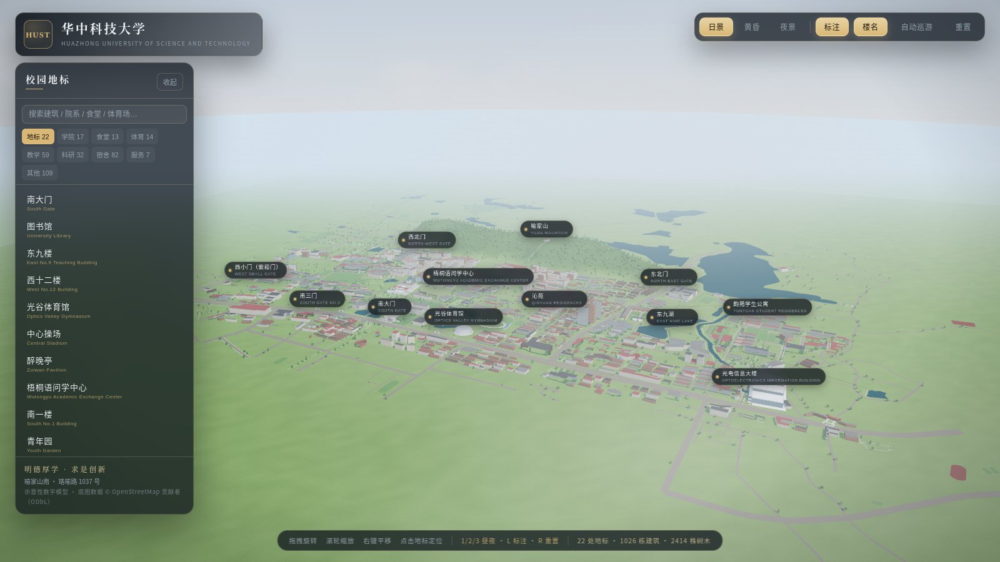

# 华中科技大学 · 3D 校园（真实地理坐标版）

基于 **OpenStreetMap 真实地图数据** 的华中科技大学校园三维模型，使用 [Three.js](https://threejs.org/) 在浏览器中实时渲染。
建筑轮廓、道路、湖泊、山体与校门位置均来自真实经纬度，按 **1 单位 = 1 米** 建模；建筑立面、树木、天空、水面与文字由代码程序化生成。



> 这是一个**示意性**数字模型（简化体量、推定层数、艺术化材质），**不是测绘成果**。
> 地图底图数据 © OpenStreetMap 贡献者，遵循 [ODbL](https://www.openstreetmap.org/copyright) 许可。

## 快速开始

```bash
node serve.mjs          # 默认 http://127.0.0.1:8080
# 或
npm start
```

用支持 WebGL2 的现代浏览器打开提示的地址。页面使用 ES Module 与 importmap，请通过 HTTP 访问。

## 交互

| 操作 | 说明 |
| --- | --- |
| 拖拽 / 滚轮 / 右键拖拽 | 旋转 / 缩放 / 平移 |
| 左侧地标列表、地图上的标签 | 平滑飞行到对应地标并显示简介 |
| 搜索框 / 分类筛选 | 「全部」列出 350 条地标与命名建筑；也可按学院 / 食堂 / 体育 / 教学 / 科研 / 宿舍 / 服务 / 其他筛选，或按名称、院系常用名搜索后点击定位 |
| `N` | 显示或隐藏建筑名称标注（近景自动出现） |
| `1` / `2` / `3` | 日景 / 黄昏 / 夜景 |
| `L` | 显示或隐藏地标标注 |
| `R` | 回到校园全景 |
| `Esc` | 关闭简介卡片 |
| 右上角按钮 | 昼夜切换、标注、自动巡游、重置视角 |

## 地理与场景内容

- **坐标系**：以 30.5175°N, 114.4130°E 为原点，x 向东、z 向南、y 向上（1 单位 = 1 米），正北为 -z。
- **建筑**：约 **1026 栋**，全部由 OSM 建筑轮廓拉伸生成；按名称/类型推定层数（3–8 层为主），并使用多种立面与屋顶材质混合。
- **道路**：约 **1068 条** 道路与步行道（珞喻路、珞喻东路、喻家湖路、喻园大道、醉晚路等），按等级设置宽度，并带路灯、行道树。
- **水体**：**47 处** 水面，包括镜湖（醉晚亭）、东九湖、喻家湖、源湖、荷塘等。
- **绿地与运动场**：**221 片** 绿地/球场/跑道（来自 OSM `leisure=pitch/track/park` 等）。
- **山体**：喻家山山体轮廓来自 OSM，主峰海拔约 **149.5 米**，山顶设观景亭与登山步道。
- **校门（7 处）**：南大门（主校门）、南二门、南三门、南四门、西小门（紫菘门）、东北门、西北门。
- **建筑名录（约 320 个有名称的建筑与场地）**：可按类别筛选、按名称或院系常用名搜索，并飞抵定位。
- **地标（22 处）**：南大门、图书馆（逸夫图书馆与老馆）、东九楼、西十二楼、光谷体育馆、醉晚亭、梧桐语问学中心（D6 修身楼）、南一楼、青年园、东九湖、喻家山、韵苑、紫菘、沁苑、光电信息大楼及各校门。
- **生活气息**：珞喻路车流、约 2455 株实例化树木、日/黄昏/夜景光照（程序化天空、IBL、阴影、窗灯、路灯）。

## 数据流程

```
OpenStreetMap (Overpass API)
        │  research/*.json        # 下载的原始数据
        ▼
research/prepare.py               # 坐标投影、轮廓简化、去重、建筑层数/风格推定
        ▼
src/campus-data.js                # 约 300 KB 的紧凑数据集（构建时生成）
        ▼
src/site.js  src/osm-buildings.js src/nature.js   # 地形/道路/水面/建筑/树木渲染
```

重新生成数据：

```bash
python3 research/prepare.py
```

下载脚本中使用的 Overpass 查询覆盖：校园边界关系、全部建筑（含 relation 成员轮廓）、道路、水体、球场、校门节点等。原始 JSON 保留在 `research/` 下便于复现。

## 目录结构

```
hust_3d/
├── index.html              # 页面骨架、HUD、importmap
├── serve.mjs               # 零依赖静态服务器
├── src/
│   ├── main.js             # 初始化、相机飞行、车流、动画与 UI
│   ├── campus-data.js      # 由 OSM 生成的校园数据集（坐标/建筑/道路/水体/绿地/校门）
│   ├── data.js             # 20 处地标的名称、位置、简介与相机视角
│   ├── site.js             # 地形（喻家山高度场）、道路、水面、绿地、广场
│   ├── osm-buildings.js    # OSM 建筑轮廓 → 合并的立面/屋顶几何 + 少量标识
│   ├── buildings.js        # 重点地标的精细模型（校门、图书馆、东九楼、体育馆、醉晚亭等）
│   ├── architecture.js     # 立面贴图、体量、坡屋顶、台阶、柱廊等构件
│   ├── nature.js           # 树木几何、种植规则（山地/绿地/行道树）
│   ├── environment.js      # 天空、星空、云、昼夜光照与 IBL
│   ├── labels.js           # 屏幕空间标签（防重叠、视口约束）
│   ├── util.js             # Canvas 贴图、文字、几何合并等工具
│   └── style.css
├── research/               # OSM 原始数据、下载结果与 prepare.py
├── vendor/                 # 本地化的 three.js r160 与 OrbitControls
└── docs/                   # 预览图
```

## 实现要点

- **真实轮廓**：建筑用真实 OSM 多边形逐边生成墙体，UV 按墙面长度/高度平铺立面贴图；屋顶单独三角化；同类立面合并为少数几次绘制。
- **山体**：以喻家山轮廓计算“到边界的距离”，生成 0–149.5 m 的高度场，并在山顶压平出观景平台。
- **水面**：所有水体合并为单一网格，颜色随昼夜变化，带凹凸波纹与岸线描边。
- **树木**：按山体、绿地、道路分别采样，并用 10 m 网格排除建筑、道路、水面与球场。
- **光照**：天空穹顶同时烘焙为 PMREM 环境贴图；日/黄昏/夜景使用与帧率无关的时间轴过渡。
- **稳定性**：对数深度缓冲、分层的路面/广场高度、标签去重叠与视口约束。

## 自定义

- 地标与相机：`src/data.js`
- 昼夜参数：`src/environment.js` 的 `PRESETS`
- 建筑风格与材质：`src/architecture.js`
- 数据范围/筛选规则：`research/prepare.py`

## 已知限制

- 建筑层数为**推定值**（OSM 多数建筑无 `height/levels`），立面为程序化贴图，非真实外观。
- 校园边界与部分设施在 OSM 中不完整或随现实更新而变化；模型随数据更新而更新。
- 水面为近似效果（环境贴图+波纹），无真实平面反射；未做移动端性能降级。
- 当前约 700 次绘制调用、60 万三角面、约 2500 株实例化树木。
